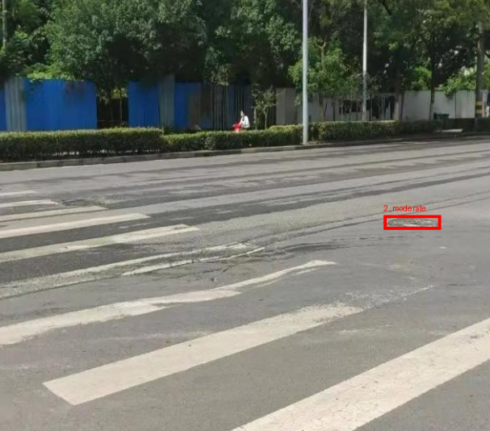
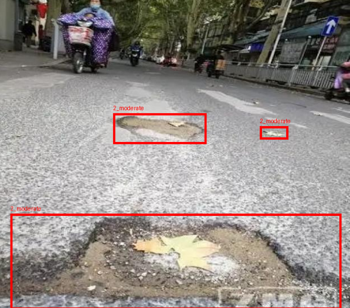
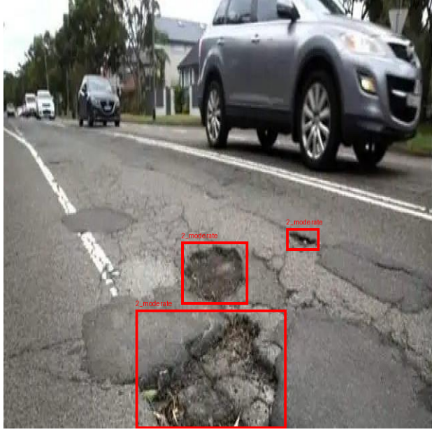
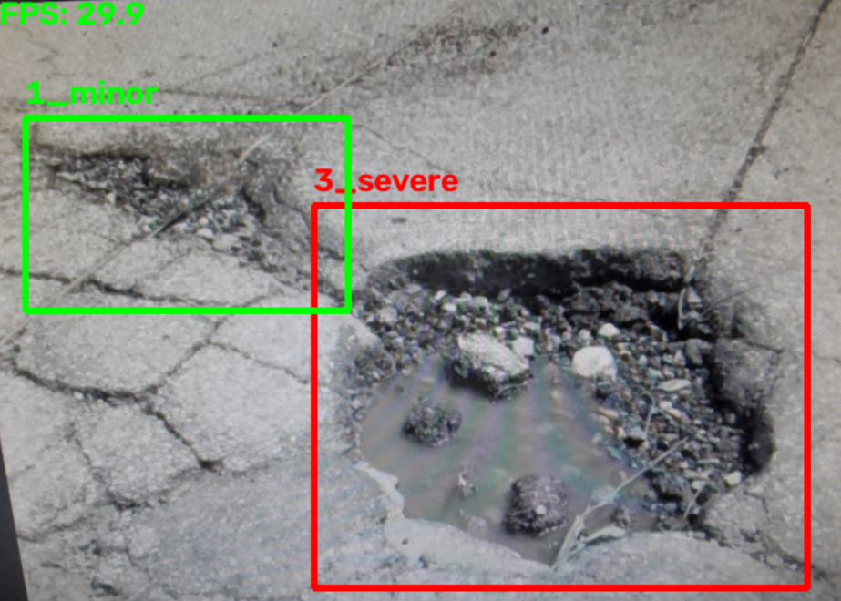
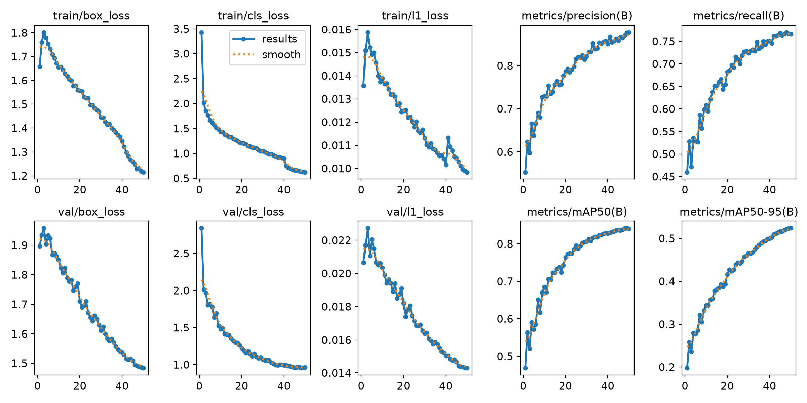
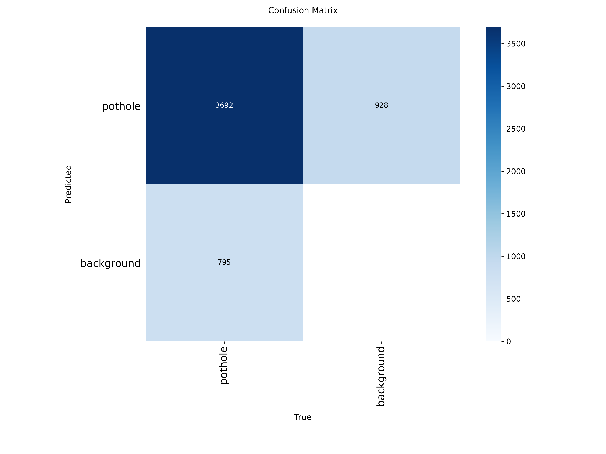

# Road Pothole Detection and Severity Classification

A two-stage computer vision pipeline. A YOLO26-nano model finds potholes in a road photo, then a ResNet18 classifier rates each pothole as **minor**, **moderate** or **severe**. It works on single photos and live on a webcam (30+ FPS on an RTX 4060 laptop GPU).

<p>
  
  
  
</p>



## How it works

```
photo or video frame -> YOLO detector -> crop each pothole -> severity classifier -> boxes + labels
```

1. **Detection (`train.ipynb`).** YOLO26-nano, trained for 50 epochs on a public Roboflow dataset of road photos with one class, `pothole`.
2. **Severity (`severity_classifier.ipynb`).** ResNet18 pretrained on ImageNet, with a new 3-output last layer and `layer4` fine-tuned. It looks at the close-up crop of each detected pothole. I first trained with every layer frozen (72 to 75% test accuracy), then unfroze `layer4`, which raised it to 79%.
3. **Pipeline (`pipeline.ipynb`, `live.py`).** Both models together, on photos and on live video.

## Results

**Detector** (890 test images): precision 0.85, recall 0.79, **mAP50 0.833**, mAP50-95 0.528. About 85% of the boxes it draws are real potholes, and it finds about 79% of the real ones.

Training curves (from the validation set, 1,808 images):



Confusion matrix (validation set, counts of boxes: 3,692 potholes found, 795 missed, 928 false alarms):



**Severity classifier** (199 test images): **79% accuracy**.

- Minor is the easiest class (recall 0.91), severe is next (F1 0.80), and moderate is the weakest (recall 0.68).
- Mistakes are mostly between neighbouring levels: a minor pothole was never called severe, and only 4 severe ones were called minor.

## Datasets

- **Detector:** [Potholes Detection on Roboflow Universe](https://universe.roboflow.com/project-ssayl/potholes-detection-d4rma/dataset/1), 13,767 images including augmented copies (horizontal flips).
- **Severity:** 1,311 pothole crops (457 minor, 434 moderate, 420 severe), made from Kaggle pothole crops and automatic crops from my YOLO detector, then sorted by hand into the three levels. Split 70/15/15 with seed 42. The dataset is not included in this repository.

## Project structure

```
train.ipynb                 # Model 1: train and evaluate the YOLO detector
severity_classifier.ipynb   # Model 2: train and evaluate the severity classifier
pipeline.ipynb              # Both models on single photos
live.py                     # Both models on webcam or video (press q to quit)
requirements.txt
images/                     # Images used in this README
```

## How to run

1. Install the libraries (for GPU support, install PyTorch with the CUDA command from pytorch.org first):

   ```
   python -m venv yolo_env
   yolo_env\Scripts\activate
   pip install -r requirements.txt
   ```

2. Download the two trained weights from the **Releases** tab of this repository and place them like this:

   ```
   runs/detect/pothole_runs/v1/weights/best.pt    # detector
   severity_layer4.pt                             # severity classifier (project root)
   ```

3. Run the live demo, or open `pipeline.ipynb` and call `analyze_photo("your_photo.jpg")`:

   ```
   python live.py
   ```

   To use a video file instead of the webcam, change `SOURCE` at the top of `live.py`.

To retrain the detector, run `train.ipynb`. It downloads the dataset from Roboflow and asks you to type your own API key. You get a free key by creating an account at [roboflow.com](https://roboflow.com) and copying it from the API keys section of your account settings.

If `cv2.imshow` fails with "The function is not implemented" after installing `roboflow`, the headless OpenCV was installed. Fix it with:

```
python -m pip uninstall -y opencv-python opencv-python-headless
python -m pip install opencv-python
```

## Limitations

- **False positives.** The detector was trained without negative examples (photos with no potholes), so at a low confidence threshold it can flag dark shadows or vegetation as potholes. The default threshold of 0.5 avoids this on my test photos, but at 0.2 it reported a dark mountain as a pothole.
- **Small, subjective severity labels.** The classifier uses about 900 training crops, labelled by one person, so the boundary between minor, moderate and severe is subjective.
- **Overfitting.** With about 900 training images and around 8 million trainable weights in `layer4`, the model starts to memorize the training crops: by epoch 10, training accuracy reached 96% while validation loss kept rising (0.34 at its lowest, 0.52 at the end). Saving the epoch with the best validation accuracy (epoch 2) limits the effect, but a gap remains between validation (85%) and test (79%) accuracy. Possible fixes that were not applied in this version: more labelled crops, stronger data augmentation (brightness, zoom, blur), weight decay or dropout, a lower learning rate for `layer4`, and averaging over several runs or cross-validation.
- **Split by crop, not by photo.** Crops of the same photo can land in both train and test, so the test score may be slightly optimistic.
- **Single run, informal testing.** Results come from one training run per model. Beyond the test sets, I only tried the pipeline on a small number of my own photos.
